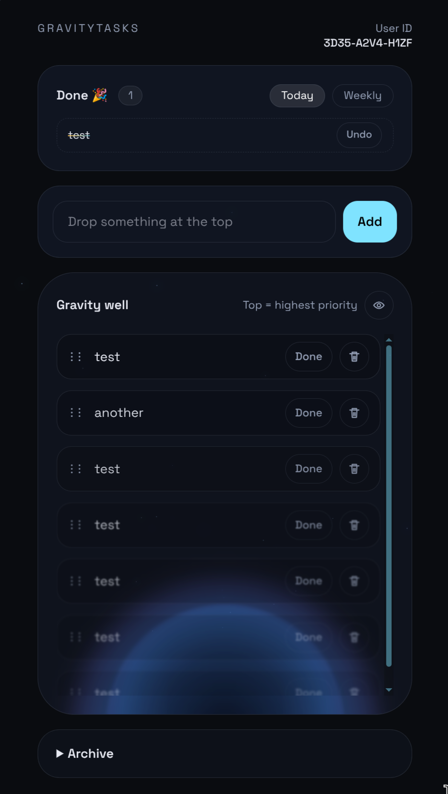

# GravityTasks

GravityTasks is a local-first todo app where priorities orbit a gravity well.
Top = highest priority, lower items fade and blur toward the bottom. 

Hence, the concept appreciates the nature of "there are always more tasks to do than one can achieve". We appreciate the finite nature of our tasks and don't let a long list stress us out - instead, we focus our effort on _relative priority_ and just do what sounds like the most important task at a given moment.

Disclaimer: This is 100% vibe coded, I didn't review a single line of code. :bomb:



## Concept
- Local-first PWA: tasks live in IndexedDB and sync to a small Rust API.
- Gravity metaphor: reorder by drag, items dissolve toward the well.
- Offline-ready: Dexie outbox + batch sync.
- Minimal onboarding: User ID only.

## Stack
- Frontend: Vue 3 + Vite + Tailwind + Pinia + Dexie
- Backend: Rust (axum) + SQLite — one ~4 MB binary that also serves the frontend
- Dev: Docker Compose

## Development (Docker)
```bash
docker compose up
```

Frontend: http://localhost:5173
Backend API: http://localhost:3000/api

Override the API URL via `.env`:
```
VITE_RAILS_API_URL=http://localhost:3000/api
```

## Production
Every push to `main` builds a static musl binary plus the frontend in CI and publishes
`gravity-tasks-x86_64-linux-musl.tar.gz` as the latest GitHub release. The host only downloads it.

One-time setup (Alpine / OpenRC):
```bash
addgroup -S gravity-tasks
adduser -S -D -H -h /var/lib/gravity-tasks -s /sbin/nologin -G gravity-tasks gravity-tasks
mkdir -p /var/lib/gravity-tasks /opt/gravity-tasks/releases
chown gravity-tasks:gravity-tasks /var/lib/gravity-tasks
cp deploy/gravity-tasks.initd /etc/init.d/gravity-tasks && rc-update add gravity-tasks
```

Deploy: `./redeploy.sh` (downloads the latest release, switches `/opt/gravity-tasks/current`, restarts).

Notes:
- App on port 3000: `/` is the PWA, `/api` the API, `/up` the health check.
- The frontend calls same-origin `/api` unless `VITE_RAILS_API_URL` is set at build time.
- DB: `/var/lib/gravity-tasks/production.sqlite3`. The schema is the one the former Rails
  backend created, so existing databases are used as-is.
- Logs: `/var/log/gravity-tasks.log`.
- Runtime config via env: `DATABASE_PATH`, `STATIC_DIR`, `PORT`, `CORS_ORIGINS` (default `http://localhost:5173`).
- Idle memory: a few MB.
